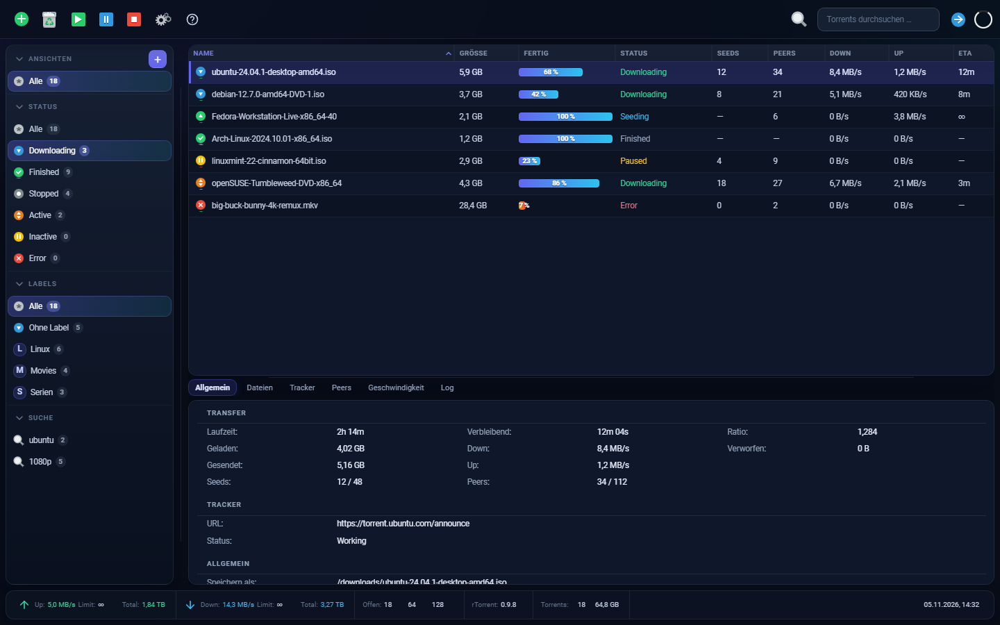
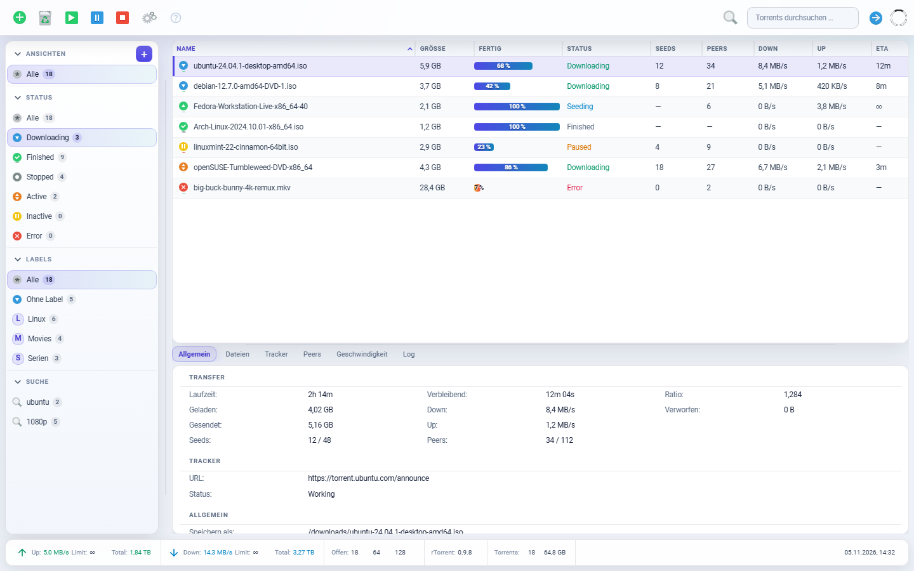

# ModernUI for ruTorrent

A modern Bootstrap 5 interface for [ruTorrent](https://github.com/Novik/ruTorrent), in **dark**
(`ModernUI`) and **light** (`ModernUI-Light`) variants. Each theme is standalone: no override of the
other, no CDN, all icons and fonts bundled.

<p align="center">
  
  
</p>

## Requirements

- ruTorrent **5.3.x** (Bootstrap 5)
- The `theme` plugin enabled (ships with ruTorrent)
- Write access to `rutorrent/plugins/theme/themes/`

## Install

1. Extract `ModernUI.zip` and/or `ModernUI-Light.zip` from [`dist/`](dist/) into
   `rutorrent/plugins/theme/themes/`. The archive already contains the correctly named folder.
2. Set ownership/permissions so the web server can read it, e.g.:

   ```bash
   sudo chown -R www-data:www-data ModernUI ModernUI-Light
   sudo find ModernUI ModernUI-Light -type d -exec chmod 755 {} \;
   sudo find ModernUI ModernUI-Light -type f -exec chmod 644 {} \;
   ```

3. Pick the theme under **Settings → Theme** and hard-reload (**Ctrl + F5**).

To make it the default, set `$defaultTheme` in `plugins/theme/conf.php`.

### Stale styles after an update

ruTorrent links the theme CSS as `style.css?v=<ruTorrent version>` — a URL that does not change when
the theme files do, so a browser or a caching proxy in front of ruTorrent can keep serving an older
build (a replaced theme then looks half updated). Both themes re-append their sheets with a
per-load nonce from `init.js`, so the files on disk always win. If something still looks outdated,
replace the whole theme folder (not single files) and reload with **Ctrl + F5**.

## Customize

Colours are CSS custom properties at the top of `style.css`. Append overrides to the end of the file
to change them:

```css
:root {
  --mui-accent: #0ea5e9;
  --mui-accent-rgb: 14, 165, 233;
  --mui-accent-2: #22d3ee;
  --mui-accent-2-rgb: 34, 211, 238;
}
```

Keep each `*-rgb` value in sync with its hex colour.


## Credits & license

Built on the bundled **MaterialDesign** theme (Phlo, LesBleus), with icons from
[small-n-flat](https://github.com/paomedia/small-n-flat) (CC0 1.0) and **Roboto** (Apache-2.0).

Released under **GPL-3.0-or-later**. See [`LICENSE`](LICENSE) and [`ATTRIBUTION.md`](ATTRIBUTION.md).

Not affiliated with the ruTorrent project. Use at your own risk.
